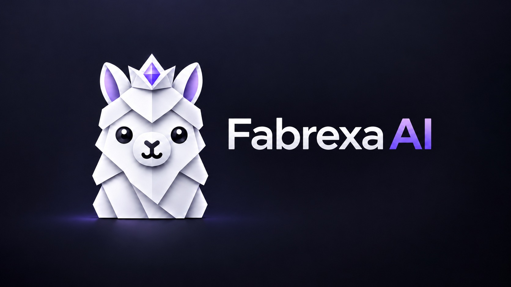

# Fabrexa AI Ollama



Fabrexa is a self-hosted Telegram bot for chatting with an LLM through Ollama and optionally turning each completed reply into a locally generated image through ComfyUI.

It gives a local model a familiar chat interface, streams replies as they are generated, supports custom personalities, and can keep short-term and long-term memory for the personalities you choose.

[](https://nodejs.org/)
[](https://ollama.com/)
[](https://telegram.org/)
[](./LICENSE)

## What it does

- Connects Telegram to a local Ollama model
- Streams the generated response into the Telegram chat
- Keeps recent messages in the active conversation
- Supports plain-text personality prompts
- Provides optional short-term and long-term memory
- Lets the user view, edit, or remove saved long-term memories
- Directs one continuity-aware image from the active session state and latest exchange, then sends it with a collapsed prompt caption
- Lets each Telegram account disable or re-enable automatic images
- Runs in private owner-only mode by default

Telegram still carries messages between you and the bot. Model inference and Fabrexa's conversation files stay on the machine running the project.

## Screenshots

<table>
    <tr>
        <td width="50%"></td>
        <td width="50%"></td>
    </tr>
    <tr>
        <td align="center">Chat with the selected local model</td>
        <td align="center">Switch personalities from Telegram</td>
    </tr>
</table>

## How it works

```text
Telegram
   ↓
Fabrexa
   ├── selected personality
   ├── recent conversation
   ├── session continuity memory
   └── allowed long-term memory
   ↓
Ollama on your computer
   ├── streamed reply in Telegram
   └── appearance + session continuity + latest exchange
           ↓
       ComfyUI image
           ↓
       Telegram photo + collapsed direction prompt
```

Fabrexa sends the active personality prompt, up to 24 recent conversation messages, the active session's bounded continuity memory, optional long-term memory, and the new message to Ollama. Recent history has an approximate 4096-token budget and is shortened from the oldest message when needed so the prompt and reply still fit the configured context window. The response is streamed back to Telegram. When automatic images are enabled, the same text model directs one still image using the selected character's separate appearance file, ordered session continuity memory, and the latest user/assistant exchange. Fabrexa records the direction, unloads the text model, runs the local ComfyUI workflow, sends the photo, unloads the image model, and preloads the text model again.

## Requirements

- [Node.js 22+](https://nodejs.org/)
- [Ollama](https://ollama.com/)
- [ComfyUI](https://github.com/comfyanonymous/ComfyUI) running locally when automatic images are available
- A bot token created with [@BotFather](https://t.me/botfather)
- Your numeric Telegram user ID when private mode is enabled
- Your public Telegram username when private mode is enabled

## Installation

### 1. Clone and install

```bash
git clone https://github.com/Ali-Sdg90/Fabrexa-AI-Ollama.git
cd Fabrexa-AI-Ollama
npm install
```

### 2. Download a model

The example configuration uses `gemma3:12b`:

```bash
ollama pull gemma3:12b
```

You can also run a compatible GGUF model from Hugging Face:

```bash
ollama run hf.co/<publisher>/<model>-GGUF:Q4_K_M
```

Use the exact model reference from the model page as `OLLAMA_MODEL`. See the [official Hugging Face Ollama guide](https://huggingface.co/docs/hub/ollama) for details.

### 3. Configure Fabrexa

Copy `.env.example` to `.env`:

```bash
cp .env.example .env
```

On Windows Command Prompt:

```bat
copy .env.example .env
```

Set the required values in `.env`:

```env
TELEGRAM_BOT_TOKEN=your_token_from_botfather
OWNER_ID=your_numeric_telegram_id
OWNER_USERNAME=your_telegram_username
BOT_PRIVATE=true
OLLAMA_MODEL=gemma3:12b
COMFYUI_CHECKPOINT_NAME=your-local-checkpoint-file.safetensors
```

Start local ComfyUI with the workflow's required core nodes available. Keep the checkpoint filename only in `.env`; the committed workflow deliberately leaves it blank. To run text-only while postponing ComfyUI setup, set `IMAGE_GENERATION_AVAILABLE=false`.

Never commit `.env` or share your Telegram bot token.

`OWNER_ID` controls who can use the private bot. `OWNER_USERNAME` is the public contact handle shown to other Telegram users, so enter it without spaces; the leading `@` is optional. When someone without access contacts the bot, Fabrexa explains that the instance is private, points them to this username to request access, and links to the GitHub project for self-hosting.

The repository includes four ready-to-use demo personalities: Friendly, Elara Voss, Sherlock Holmes, and Vent Girl. Chat prompts live in `personalities/prompts/`, while image-only appearance references live in `personalities/appearances/`. Add matching `.txt` filenames to both folders for a custom personality.

### 4. Check and run

Make sure Ollama is running, then use:

```bash
npm run check
npm start
```

Open the bot in Telegram, send `/start`, and type a message.

## Using the bot

Fabrexa responds to normal text messages and provides four quick actions:

| Action | Purpose |
| --- | --- |
| **New Chat** | Starts a new conversation without deleting long-term memory |
| **Change Personality** | Selects another prompt and starts a new conversation |
| **Show Memory** | Shows editable long-term memories for the active personality |
| **Image Settings** | Enables or disables automatic images for that Telegram account |

## Automatic images

Automatic images are enabled by default for every personality. The preference is stored per Telegram user, so changing personalities or starting a new chat does not reset it.

The image director receives four isolated inputs: the selected character's appearance file for stable identity traits and defaults; ordered continuity memory from earlier turns in the active session; the latest assistant reply for the immediate narrative moment; and the latest user message for the requested scene and changes. Later memory entries override earlier conflicting state, the latest exchange overrides memory, and explicit details in the latest user message take precedence when the two latest messages conflict. All source blocks are treated as data rather than instructions. The director never receives the personality system prompt, raw earlier history, or long-term memory. If `src/image/additional-scene-prompt.txt` exists and contains text, its private instructions are appended to the main scene-director system prompt; when it is missing or empty, only `src/image/scene-director.txt` is used. The optional path can be changed with `IMAGE_ADDITIONAL_SCENE_PROMPT_PATH`. The prompt specifies the exact number of visible people, puts each depicted person's gender in parentheses after every name, and includes a time of day and plausible clock time. The assistant character stays visually dominant, while the user is omitted unless their physical presence is necessary. The generated direction is saved both as a non-conversational session artifact and under `chat_memory/users/<telegram-id>/image-generation.json`; artifacts are deliberately excluded from later chat context.

The Telegram photo caption contains the prompt used by ComfyUI inside an expandable HTML blockquote. Scene prompts are not length-limited before storage or generation; when one exceeds Telegram's fixed photo-caption limit, only the displayed caption becomes a shortened preview. While ComfyUI is working, the bot shows only `Your image is being created...`; that status is removed after the photo arrives.

Every generated photo has a **Regenerate** button. It looks up the complete saved direction for that user and chat, queues a new GPU handoff, unloads the text model, generates a fresh image with a new seed, sends it as a separate photo with the same caption and button, unloads the image model, and restores the text model. The callback contains only a stored prompt ID, never the prompt itself.

Before streaming starts, a compact placeholder shows the text model, image model, active personality, and memory state. The first streamed text chunk immediately replaces that placeholder. After the photo is delivered, Fabrexa prints per-stage timings for queueing, text preparation/generation/delivery, scene direction, model handoff, image generation/delivery, cleanup, and the full request, then stores the same report as a non-conversational artifact in the active session file.

## Memory

Conversation history and the optional memory system are separate:

- The active conversation supplies recent messages to the model.
- Every session has private chronological continuity memory for story events,
  character state, clothing, locations, relationships, goals, and other details
  needed in later turns. It is active for every personality and is discarded
  from prompt context when a new session starts.
- Short-term memory stores useful facts identified from user messages.
- The scheduled processor promotes stable and important facts to long-term memory.
- Long-term memory is added to future prompts and remains available across new chats.

After the latest reply and optional image pipeline finish, the same local Ollama
model reviews only that user message and assistant response. Its strict JSON
result is appended to `chat_memory/<chat-id>/sessions/<session-id>/session-memory.json`.
The paired `chat.txt` contains the session transcript. This background analysis
runs at lower queue priority than incoming conversations and has no Telegram UI.
A bounded recent portion of the ordered memory is supplied to later chat replies
and image direction. The existing short-term and long-term memory files remain
separate at chat level.

Memory is enabled by default for Friendly and Vent Girl:

```env
MEMORY_ENABLED_PERSONALITIES=Friendly,Vent Girl
```

Change the list to use memory with different personalities, or leave it empty to disable memory for all personalities.

Memory files are stored locally in `chat_memory/` and are ignored by Git.

## Common configuration

| Variable | Purpose | Example or default |
| --- | --- | --- |
| `TELEGRAM_BOT_TOKEN` | Telegram bot token | Required |
| `OWNER_ID` | Allowed Telegram user in private mode | Required when private |
| `OWNER_USERNAME` | Public contact shown to users denied access | Required when private |
| `BOT_PRIVATE` | Restrict the bot to `OWNER_ID` | `true` |
| `OLLAMA_BASE_URL` | Ollama server address | `http://127.0.0.1:11434` |
| `OLLAMA_MODEL` | Model used for chat | `gemma3:12b` in `.env.example` |
| `OLLAMA_KEEP_ALIVE` | Text-model idle retention | `5m` |
| `IMAGE_GENERATION_AVAILABLE` | Makes automatic images available to users | `true` |
| `COMFYUI_BASE_URL` | Local ComfyUI server | `http://127.0.0.1:8188` |
| `COMFYUI_CHECKPOINT_NAME` | Private runtime checkpoint filename | Required for images; keep only in `.env` |
| `OLLAMA_NUM_CTX` | Context window | `8192` |
| `OLLAMA_MAX_TOKENS` | Maximum generated tokens | `2048` |
| `OLLAMA_MIN_RESPONSE_WORDS` | Minimum combined response length; `0` disables continuation | `250` |
| `OLLAMA_MAX_CONTINUATIONS` | Maximum extra requests for a short response | `2` |
| `CHAT_HISTORY_MAX_MESSAGES` | Maximum previous messages considered per reply | `24` |
| `CHAT_HISTORY_MAX_TOKENS` | Approximate token budget for previous messages | `4096` |
| `MEMORY_ENABLED_PERSONALITIES` | Personalities allowed to use memory | `Friendly,Vent Girl` |
| `LOG_MODE` | Enables detailed payload logs when set to `dev-mode` | `normal` |

The complete reference is in [`.env.example`](./.env.example) and [Project Guide](./docs/PROJECT_GUIDE.md).

## Commands

```bash
npm start               # Start the bot
npm run dev             # Start using Node's .env loader
npm run check           # Run lint, tests, and the local setup check
npm run check:setup     # Check environment values, Ollama, and the model
npm run lint            # Run ESLint
npm test                # Run the focused automated tests
npm run memory-process  # Process short-term memory manually
```

`npm run check` runs lint, the focused tests, and `npm run check:setup`. The setup check confirms that the local requirements, paired personality prompt/appearance files, environment values, Ollama server, selected text model, private ComfyUI checkpoint setting, workflow files, and ComfyUI queue are available. It does not contact Telegram to validate the bot token or run a real generation. A success message is printed only after every check passes.

## Project structure

```text
src/
├── ai/              # Ollama request and streaming client
├── bot/             # Telegram handlers, actions, and access control
├── config/          # Environment configuration
├── image/           # Scene direction, ComfyUI, GPU handoff, queue, and user image settings
├── memory/          # Conversation, short-term, and long-term memory
└── personalities/   # Personality file loader

personalities/
├── prompts/         # Chat personality prompts
└── appearances/     # Image-only character appearance references
chat_memory/         # Local runtime data, created automatically
public/              # Static project website
docs/                # Focused technical and troubleshooting guides
scripts/             # Maintenance tools and optional Windows autostart helper
```

## Project website

[Visit the live project website](https://ali-sdg.is-a.dev/Fabrexa-AI-Ollama/).

The landing page is plain HTML, CSS, and JavaScript. Preview it locally with:

```bash
python -m http.server 8000 --directory public
```

Then open `http://localhost:8000`.

## Documentation

- [Project guide](./docs/PROJECT_GUIDE.md) for architecture, configuration, and implementation details
- [Troubleshooting](./docs/TROUBLESHOOTING.md) for common setup and runtime problems
- [Windows autostart helper](./scripts/windows-autostart/README.md) for starting Nekoray, Ollama, and Fabrexa after sign-in
- [Contributing](./CONTRIBUTING.md) for the development workflow

## Author

Designed and developed by **Ali Sadeghi**.

## License

Fabrexa AI is available under the [MIT License](./LICENSE).
